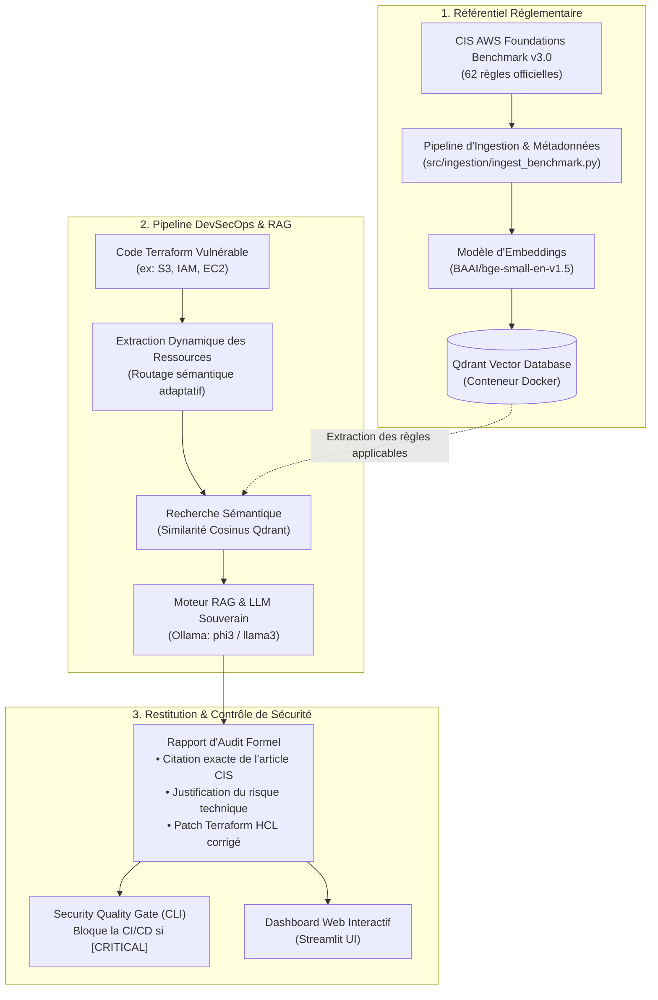

# 🛡️ CloudGuard AI : DevSecOps & Cloud Compliance Copilot

[](https://www.python.org/)
[](https://www.docker.com/)
[](https://qdrant.tech/)
[](https://ollama.ai/)
[](https://www.llamaindex.ai/)
[](https://streamlit.io/)
[](https://github.com/features/actions)

> **Plateforme RAG souveraine et autonome d'audit de sécurité et de conformité pour l'Infrastructure-as-Code (Terraform), alignée sur le standard officiel CIS Amazon Web Services Foundations Benchmark v3.0.**

---

## 📌 Contexte & Problématique Métier

Plus de **80% des failles de sécurité et fuites de données dans le Cloud** proviennent d'erreurs de configuration dans le code d'infrastructure (buckets S3 publics, identités IAM avec privilèges excessifs `*`, ports sensibles exposés, absence de chiffrement en transit ou au repos).

Les équipes d'ingénierie font face à un défi majeur :
* **Des réglementations volumineuses et complexes :** Les référentiels de sécurité (**CIS Benchmarks, NIST SP 800-53, ISO 27001, NIS2**) comptent plusieurs centaines de pages de directives techniques.
* **Le goulot d'étranglement de l'audit manuel :** Les experts en cybersécurité ne peuvent pas auditer manuellement chaque Pull Request de code Terraform déployée au quotidien.

**CloudGuard AI** comble ce fossé en automatisant l'audit de conformité réglementaire directement dans le cycle de vie DevSecOps via une architecture **RAG (Retrieval-Augmented Generation) 100% souveraine et locale**.

---

## 🏗️ Architecture Technique



---

## ✨ Fonctionnalités Majeures

1. **Architecture RAG 100% Souveraine & Locale :**
   * Zéro fuite de données vers des APIs tierces.
   * Fonctionne entièrement en local via Docker (**Qdrant**), HuggingFace (**BGE Embeddings**) et **Ollama** (`phi3` / `llama3`).
2. **Routage Sémantique Adaptatif (Zéro Biais Statique) :**
   * Analyse syntaxique préalable du code HCL pour identifier dynamiquement les types de ressources (`aws_s3_bucket`, `aws_iam_user`, `aws_instance`) et formuler des requêtes vectorielles ciblées.
3. **Zéro Hallucination & Citations Réglementaires Strictes :**
   * Chaque violation est formellement liée à son identifiant officiel CIS (ex : `CIS 2.1.1`, `CIS 2.1.4`) avec justification et remédiation HCL prête à être copiée.
4. **DevSecOps Security Quality Gate (Intégration CI/CD) :**
   * Un CLI d'audit (`audit_gate.py`) qui renvoie un code d'erreur `exit(1)` en cas de faille critique pour stopper les déploiements non conformes dans **GitHub Actions**.
5. **Dashboard Web Interactif (Streamlit) :**
   * Visualisation du code HCL, monitoring des règles CIS extraites, génération de rapport en streaming et téléchargement du rapport en Markdown.

---

## 📁 Structure du Projet

```text
├── .github/
│   └── workflows/
│       └── compliance-gate.yml       # Pipeline CI/CD GitHub Actions
├── data/
│   ├── benchmarks/                   # Référentiel CIS AWS Foundations Benchmark
│   └── test_iac/                     # Code d'infrastructure de test (TerraGoat)
├── reports/                          # Rapports d'audit générés au format Markdown
├── src/
│   ├── cli/
│   │   └── audit_gate.py             # CLI DevSecOps bloquant (Quality Gate)
│   ├── engine/
│   │   └── audit_engine.py           # Moteur RAG & génération des remédiations
│   ├── ingestion/
│   │   └── ingest_benchmark.py       # Téléchargement et indexation dans Qdrant
│   └── ui/
│       └── app.py                    # Application Web Streamlit
├── docker-compose.yml                # Définition du conteneur Qdrant Vector Store
├── requirements.txt                  # Dépendances Python
├── .env.example                      # Template des variables d'environnement
├── .gitignore
└── README.md
```

---

## 🚀 Guide de Démarrage Rapide

### 1. Prérequis
* **Python 3.11**
* **Docker Desktop** (lancé)
* **Ollama** avec le modèle `phi3` ou `llama3` installé :
  ```powershell
  ollama pull phi3
  ```

### 2. Installation de l'environnement
```powershell
# Cloner le dépôt
git clone <votre-url-github>
cd "New Project PFE"

# Créer et activer l'environnement virtuel
python -m venv venv
.\venv\Scripts\Activate.ps1

# Installer les dépendances
pip install -r requirements.txt

# Configurer l'environnement
Copy-Item .env.example .env
```

### 3. Démarrer la base vectorielle Qdrant
```powershell
docker compose up -d
```
> Le tableau de bord Qdrant sera accessible sur : `http://localhost:6333/dashboard`.

### 4. Indexer les règles de sécurité CIS
```powershell
python src/ingestion/ingest_benchmark.py
```

### 5. Lancer le Security Quality Gate DevSecOps (CLI)
```powershell
python src/cli/audit_gate.py --path data/test_iac/terragoat/terraform/aws/s3.tf --fail-on-critical
```

### 6. Lancer le Dashboard Web Interactif (Streamlit)
```powershell
python -m streamlit run src/ui/app.py
```
> L'interface s'ouvre sur : `http://localhost:8501`.

---

## 📊 Exemple de Résultat d'Audit

```markdown
**Ressource** : aws_s3_bucket.data
**Règle CIS violée** : CIS 2.1.1 - Ensure S3 Bucket Policy is set to deny HTTP requests
**Sévérité** : [HIGH]
**Risque** : Le bucket accepte les connexions non sécurisées en clair, exposant les données au transit non chiffré.
**Remédiation HCL** :
resource "aws_s3_bucket_policy" "data" {
  bucket = aws_s3_bucket.data.id
  policy = <<POLICY
{
  "Sid": "DenyHTTP",
  "Effect": "Deny",
  "Principal": "*",
  "Action": "s3:*",
  "Resource": "arn:aws:s3:::${aws_s3_bucket.data.id}/*",
  "Condition": {
    "Bool": {
      "aws:SecureTransport": "false"
    }
  }
}
POLICY
}
```

---

## 🛣️ Feuille de Route (Roadmap)

- [x] Indexation sémantique des 62 règles du standard officiel CIS AWS Benchmark v3.0.
- [x] Extraction dynamique des ressources Terraform et formulation de requête adaptative.
- [x] Moteur RAG avec streaming des remédiations de code HCL.
- [x] Intégration DevSecOps CI/CD (Quality Gate CLI + GitHub Actions).
- [x] Interface utilisateur Web interactive sous Streamlit.
- [ ] **Évaluation formelle quantitative via RAGAS** (*Faithfulness, Context Precision, Answer Relevancy*).
- [ ] Extension multi-cloud et conteneurs : intégration des benchmarks **CIS Kubernetes (EKS)** et **CIS Azure**.
- [ ] Génération automatique de politiques **Open Policy Agent (OPA Rego)** en complément du code Terraform.

---

## 📜 Licence
Projet sous licence MIT - Développé à des fins académiques et professionnelles.
